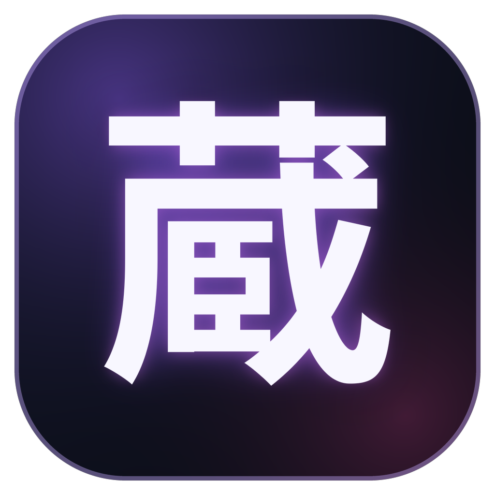

# Kura 蔵

<p align="center">
  
  <br>
  <strong>A Japanese immersion & anime suite for desktop.</strong>
  <br>
  <em>Watch local or streamed anime with synced Japanese subtitles, instant Yomitan lookups, Anime4K upscaling, and vocabulary tracking — all in one Tokyo Night workspace.</em>
</p>

---

Kura is a free, open-source desktop app built for watching anime and immersing in Japanese. It combines a fast local & streaming library, a native `libmpv`-powered player with real-time **Anime4K** shaders, automatic **Jimaku** Japanese subtitle downloading & retiming, pause-to-hover **Yomitan** dictionary lookups, a **Looked-Up Words Leaderboard**, and two-way **AniList** sync.

## Why Kura

Immersion usually means juggling a video player, a subtitle site, an audio/subtitle retiming tool, a browser dictionary extension, a spreadsheet/timer, and an episode tracker. Kura puts the entire loop in one window:

1. **Find something to watch** — your local folders, your AniList lists, or the full AniList seasonal/discover catalog.
2. **Play locally or stream** — play your own MKV/MP4 files directly, or install community **Seanime** web-streaming & torrent extensions in **Settings → Extensions** (Kura ships with **zero built-in piracy sources**).
3. **Get synced Japanese subtitles automatically** — fetched from [Jimaku](https://jimaku.cc) and aligned to your exact video's dialogue track, handling intro bumpers and commercial-break shifts automatically.
4. **Hover to look up & revise** — pause, hover any Japanese word for instant readings, pitch accent, frequency, and definitions, and review your most-looked-up words in the **Immersion Hub**.

## Features

### Japanese Immersion Suite
- **Pause-to-hover Yomitan dictionary** — hover any word in Japanese subtitles to deinflect conjugations (`食べさせられた` → `食べる`) and see furigana, meanings, pitch-accent contours, frequency badges, audio pronunciation, and kanji breakdowns.
- **Looked-Up Words Leaderboard & Revision Bank (`/immersion`)** — every word you look up is counted and ranked (`20×` → `1×`) with captured anime context sentences, Migaku-style **Track / Known / Ignore** statuses, live subtitle underlining, self-test flashcards, and 1-click TSV/Anki export.
- **Immersion time analytics** — automatic active-playback timer, daily goal ring (`15m`–`120m`), streak counter, 14/30-day velocity chart, manual external immersion logging, and optional AniList custom immersion list filtering.
- **Bring your own dictionaries** — 1-click JMdict + KANJIDIC download, or stream-import any Yomitan `.zip` dictionary.
- **Automatic Jimaku subtitle retiming** — aligns TV-timed Japanese subtitles against embedded MKV or stream WebVTT reference cues (including piecewise commercial-break shifts) without corrupting original subtitle files.
- **Episode & Jimaku subtitle alerts** — system-tray notifications when a Watching episode airs and again when its Japanese subtitles land on Jimaku.

### Watching & Streaming
- **Native `libmpv` player + Anime4K v4 GPU shaders** — zero-transcode 10-bit HEVC / AV1 / FLAC / Opus / TrueHD playback, instant dual-audio & subtitle track switching, live **Anime4K** upscaling presets (`A4K` button or `Shift+A`), AniSkip OP/ED skip, and `Z` / `X` subtitle timing controls.
- **External player integration** — seamless support for standalone `mpv` (with Kura's Tokyo Night Lua OSD & IPC sync), VLC, and MPC-HC/BE.
- **Seanime-compatible extension ecosystem** — install Seanime `onlinestream-provider` (HLS `.m3u8` / MP4 soft-sub web streaming) and `anime-torrent-provider` extensions, GitHub extension repos, or RSS / SubsPlease / SeaDex feeds inside an isolated CSP-enforced Web Worker sandbox.
- **Built-in BitTorrent engine** — sequential piece streaming, **Stream & Save** hybrid library mode, MSE/PE RC4 stream encryption, warm Mainline DHT, batch episode file picker, and 85% next-episode preloading.

### Library & Tracking
- **Tokyo Night (`蔵 · 東京ナイト`) interface** — responsive glassmorphic navigation, full-bleed hero banners, season-grouped library cards, and 100-episode range tabs for long-running series.
- **Two-way AniList sync** — imports your lists, scrobbles watched episodes automatically (with an offline retry queue), and shows weekly broadcast countdowns in `/calendar`.
- **Global search (`Ctrl+K`)**, **Discord Rich Presence**, **secret-redacted safety backups**, and **signed in-app updates**.

## Download

Grab the latest installer from **[GitHub Releases](https://github.com/wantingCat/kura/releases)**:

- **Windows (`x64`)** — `.exe` installer (recommended, includes `libmpv-2.dll`) or `.msi`
- **macOS** — `.dmg` (`aarch64` for Apple Silicon, `x64` for Intel; uses Homebrew/system `mpv`)
- **Linux (`x86_64`)** — `.deb` (Ubuntu/Debian), `.rpm` (Fedora/openSUSE), or `.AppImage` (`mpv` installed automatically via `apt`/`dnf` or Kura's 1-click installer)

Kura checks for updates automatically — when a new release is out, click **Update & restart** in-app.

> [!NOTE]
> Builds aren't code-signed with paid OS certificates yet. On Windows, if SmartScreen appears, click **More info → Run anyway**. On macOS, right-click **Kura.app** and choose **Open** on first launch.

### Getting Started
1. Add a local anime folder on first launch, or enable **Streaming Mode** in **Settings → Playback** and add your own extension repo in **Settings → Extensions**.
2. Add a free [Jimaku API key](https://jimaku.cc/account) in **Settings → Integrations** for automatic Japanese subtitles.
3. Download the full JMdict + KANJIDIC dictionaries in **Settings → Audio & Subtitles**.
4. Connect your **AniList** account in **Settings → Integrations** for two-way progress sync.

## Building from Source

**Prerequisites:** [Node.js](https://nodejs.org) 20+, [Rust](https://rustup.rs) (stable), and the [Tauri v2 prerequisites](https://v2.tauri.app/start/prerequisites/) for your OS.

```sh
npm install
npm run tauri dev
```

| Command | Purpose |
| :--- | :--- |
| `npm run check` | Svelte 5 & TypeScript typecheck |
| `cargo test --lib` (in `src-tauri`) | Run all 86 Rust unit tests |
| `npm run tauri build` | Build production binary & OS installers |

**Stack:** Tauri v2 · Rust (`tokio`, `rusqlite` WAL pool, `reqwest` rustls) · SvelteKit / Svelte 5 runes · `libmpv` + Anime4K GLSL. Metadata from [AniList](https://anilist.co), [ani.zip](https://api.ani.zip), and [Jikan](https://jikan.moe); Japanese subtitles from [Jimaku](https://jimaku.cc).

## License

[GPL-3.0-or-later](LICENSE). Forks and redistributed versions must remain free and open source under the same license.
